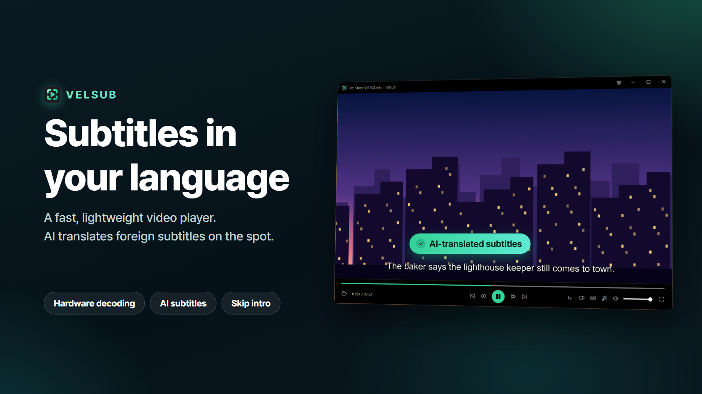
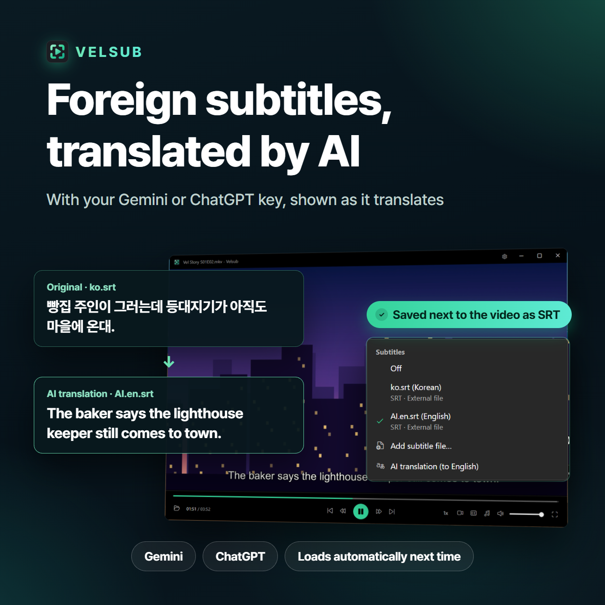
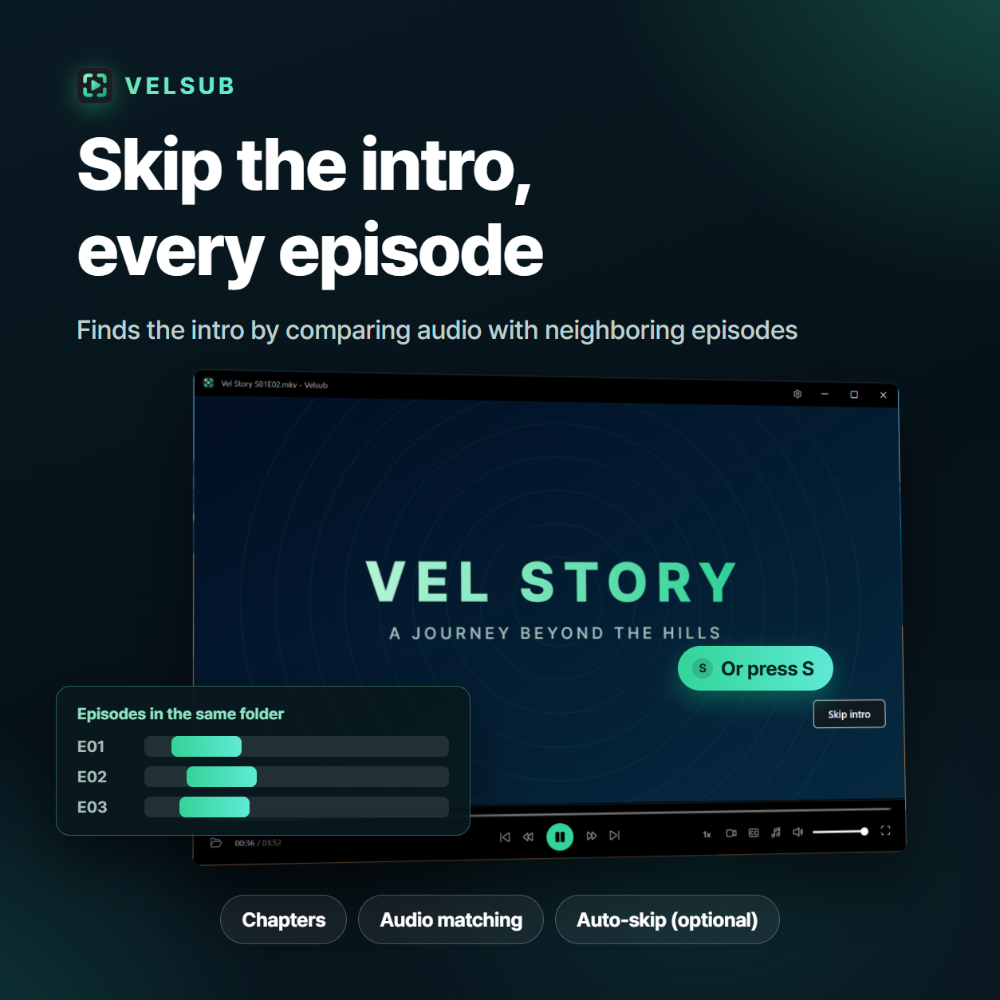
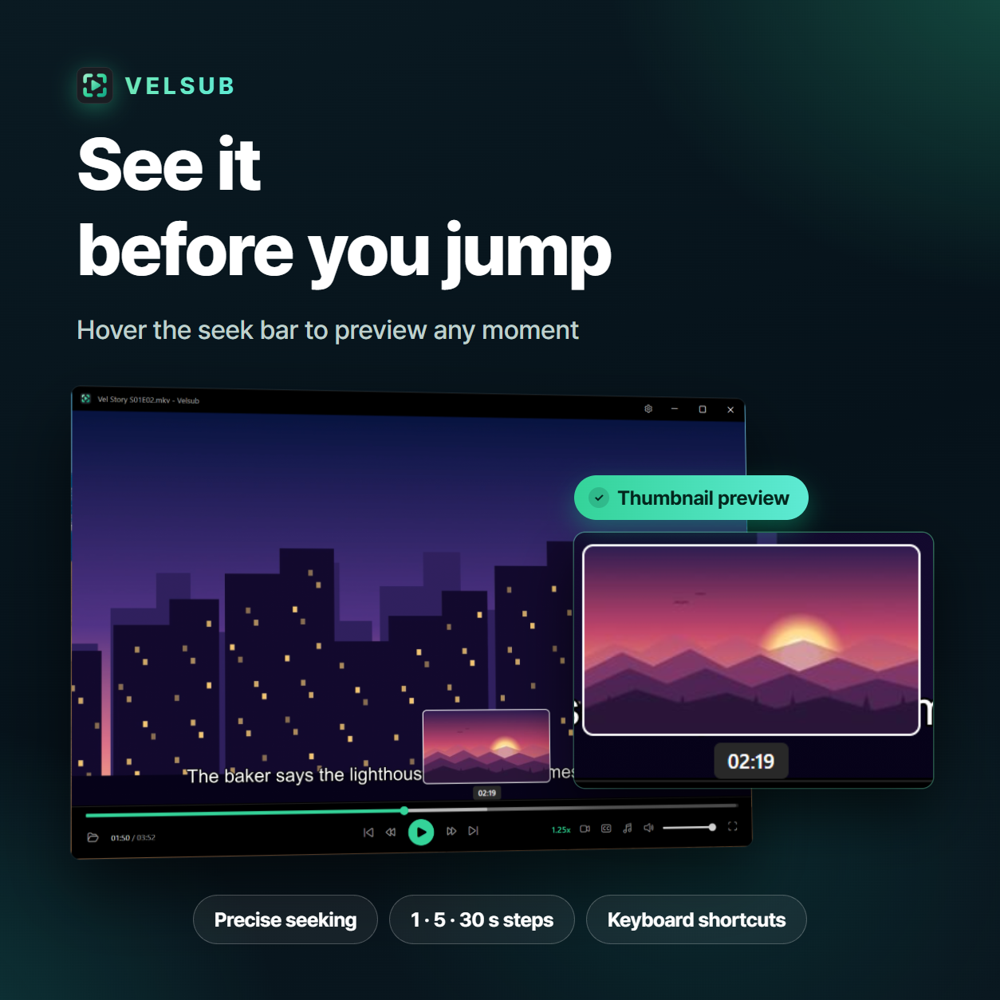
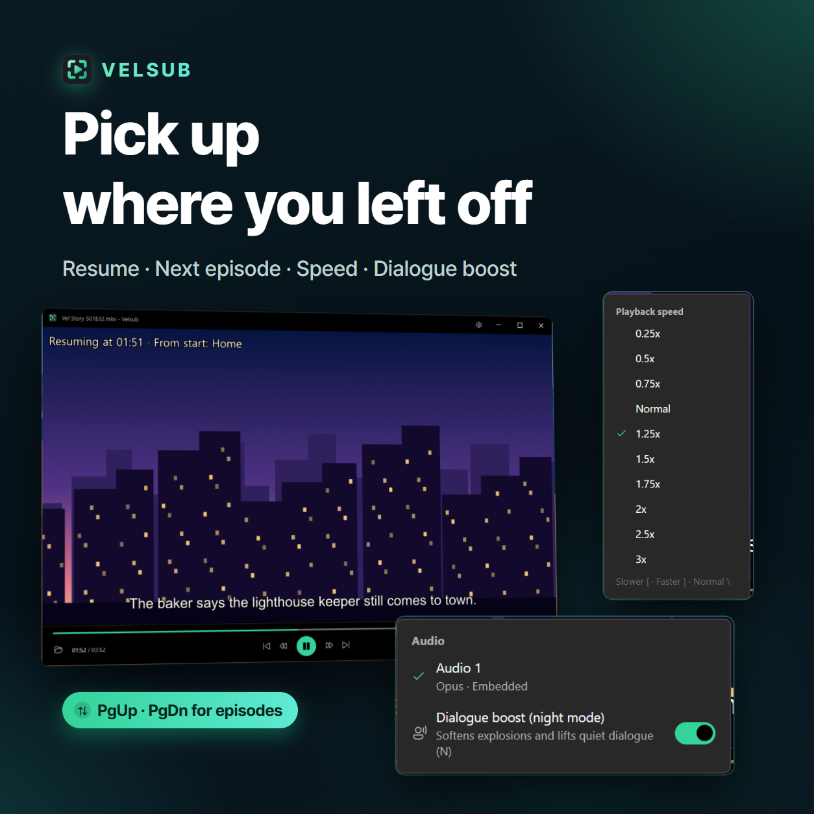
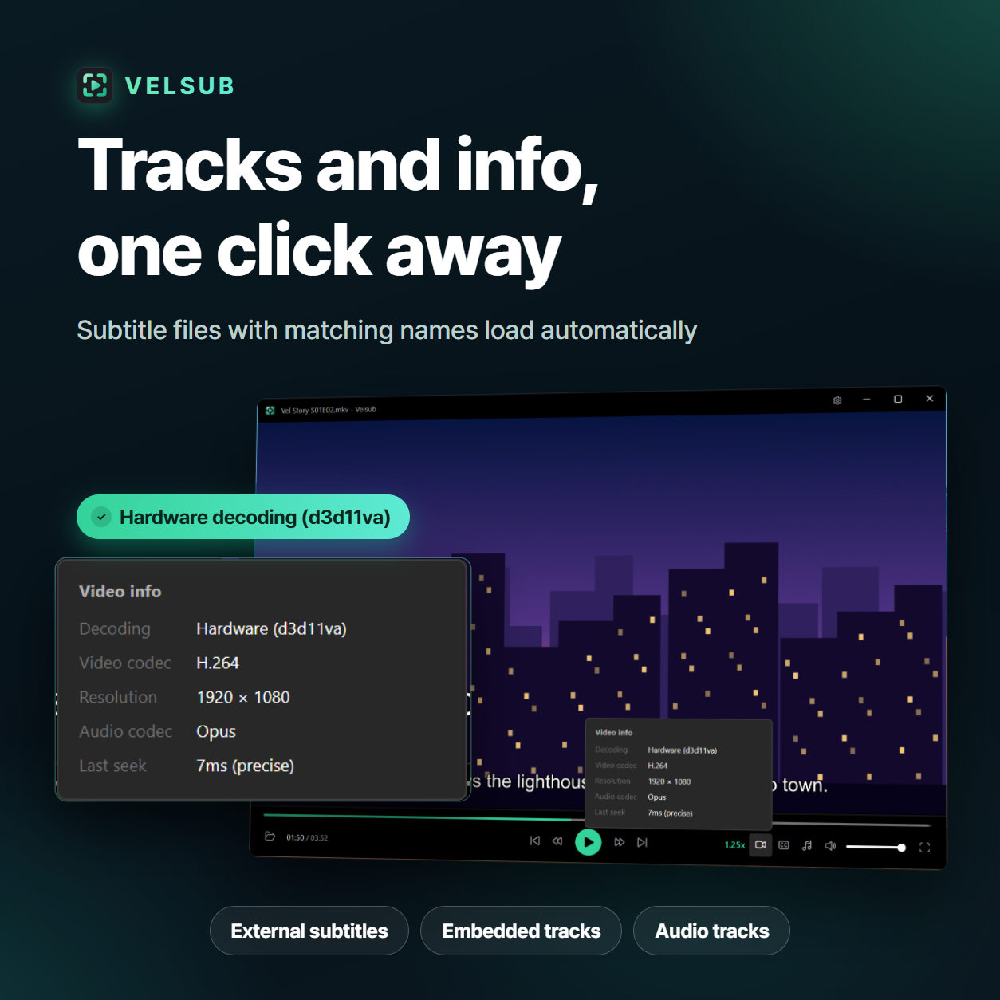
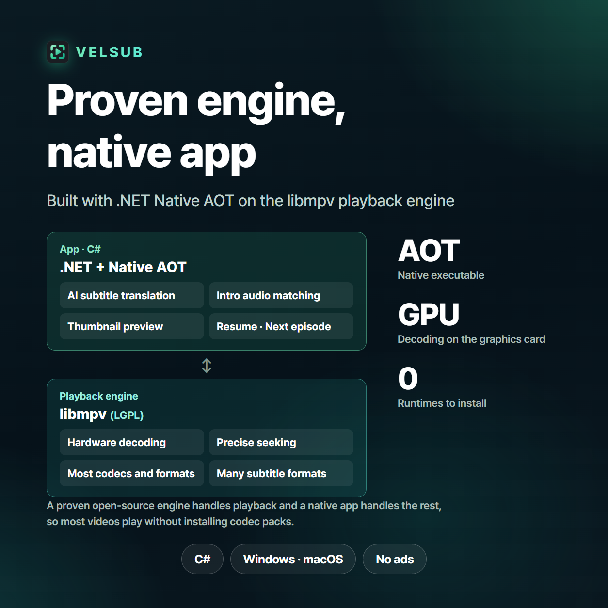

  

<h1 align="center">Velsub</h1>

A light, fast video player that translates foreign subtitles with AI

  <a href="README.md">한국어</a> · <b>English</b>

  <a href="https://github.com/vel-apps/velsub/releases/latest"><b>⬇ Download the latest version</b></a>

## Features

- **AI subtitle translation** — press "AI translation" in the subtitle panel and Velsub translates the current subtitles, showing each line as soon as it's ready and saving an SRT file next to the video. Uses your Gemini or ChatGPT (OpenAI) API key.
- **Skip intro** — a "Skip intro" button appears during the opening. Even without chapters, Velsub finds the intro by comparing the audio of neighboring episodes in the same folder. Auto-skip is optional.
- **Seek bar preview** — hover the seek bar to see a thumbnail of that moment.
- **Fast keyboard seeking** — tap an arrow key for a precise jump, hold it to fly through without the picture freezing.
- **Resume · next episode** — reopen a video to continue where you left off; when it ends, the next episode in the folder plays.
- **Speed · dialogue boost** — 0.25× to 3× without changing pitch, and a night mode that softens explosions and lifts quiet dialogue.
- **Subtitle and audio tracks** — embedded and external subtitles in one list; subtitle files with matching names load automatically (SRT · SMI · ASS · WebVTT).
- **Hardware decoding** — decoding runs on the graphics card, and most videos play without installing codec packs.
- **Korean and English** — follows the Windows display language, or choose it in Settings.

| | |
|---|---|
|  |  |
|  |  |
|  |  |

## Install

1. Download `Velsub-<version>-win-x64.zip` from [Releases](https://github.com/vel-apps/velsub/releases/latest).
2. Unzip it anywhere you like (for example `D:\Apps\Velsub`).
3. Run `Velsub.exe`. Nothing else needs to be installed.
4. To open videos with Velsub by double-clicking them: Settings → File associations.

### If Windows shows "Windows protected your PC" on the first run

Click <b>[More info] → [Run anyway]</b>. Velsub is a new program that isn't code-signed yet, so Windows asks once.

## Using AI subtitle translation

1. Get an API key from your own account (usage is billed according to each service's pricing).
   - Gemini: [Google AI Studio](https://aistudio.google.com/apikey)
   - ChatGPT: [OpenAI API keys](https://platform.openai.com/api-keys)
2. In Settings → AI translation, choose the service and enter your key. Pick the target language there too (Korean · English · Japanese · Simplified Chinese).
3. Open a video, then click CC → **AI translation**.

- Your key is stored encrypted for your Windows user account, and nothing but the subtitle text being translated is sent anywhere.
- The translation is saved next to the video as `video name.AI.en.srt` and loads automatically next time.
- If you stop midway or quit Velsub, CC → "Resume AI translation" translates only the remaining lines.
- Image-based subtitles (PGS, VobSub) can't be translated yet.

## Requirements

- Windows 10 or Windows 11, 64-bit
- A graphics card with hardware video decoding is recommended

## Tips

| Key | Action |
|---|---|
| `←` `→` | Seek 5 s (`Shift`: 1 s, `Ctrl`: 30 s · adjustable in Settings) |
| `Space` | Play / pause |
| `↑` `↓` · mouse wheel | Volume |
| `S` | Skip intro (while the button is shown) |
| `PgUp` `PgDn` | Previous / next file |
| `Home` | Play from the beginning |
| `[` `]` `\` | Slower / faster / normal speed |
| `C` | Subtitles on / off |
| `N` | Dialogue boost (night mode) |
| `M` | Mute |
| `Enter` · double-click the video | Full screen |
| `Ctrl` + `O` | Open file |
| `Ctrl` + `,` | Settings |

- You can change shortcuts in Settings → Shortcuts, up to two per action.
- You can also drag video and subtitle files onto the window.
- Settings are stored in `%APPDATA%\Velsub`.
- To uninstall, delete the unzipped folder. To remove settings too, also delete `%APPDATA%\Velsub` and `%LOCALAPPDATA%\Velsub`. If you set up file associations, turn them off in Settings → File associations first.

## Feedback

Please open an issue in [Issues](https://github.com/vel-apps/velsub/issues).

## Terms of use

Velsub is **free** for everyone, for personal and work use alike.

We've built and tested it with care, but we can't promise it will work perfectly on every PC with every video.
AI translations are for reference and may differ from the original. We can't take responsibility for problems or data loss that occur while using it — thank you for understanding.
If something bothers you, please tell us in [Issues](https://github.com/vel-apps/velsub/issues); it helps make Velsub better.

## License

© 2026 SHOCAT

Velsub uses [libmpv](https://mpv.io) (LGPL) as its playback engine. Open-source components included in Velsub, their licenses and source locations are listed in [THIRD-PARTY-NOTICES.txt](THIRD-PARTY-NOTICES.txt).
