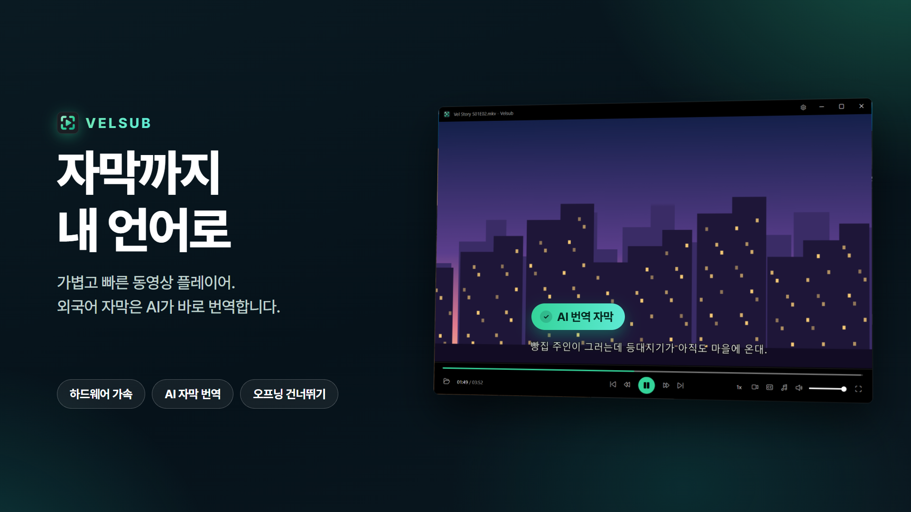
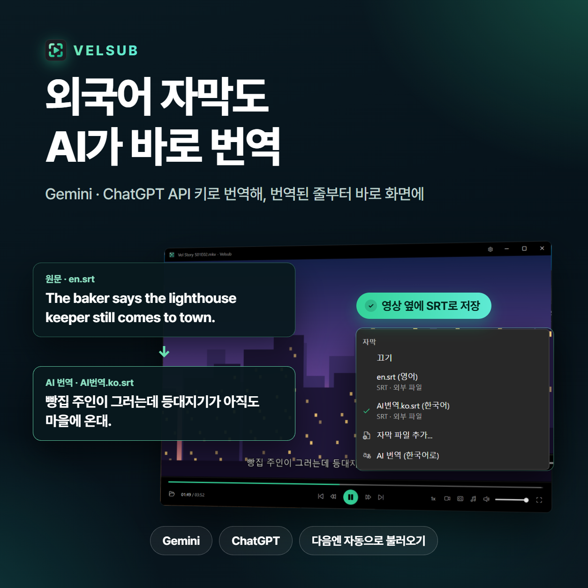
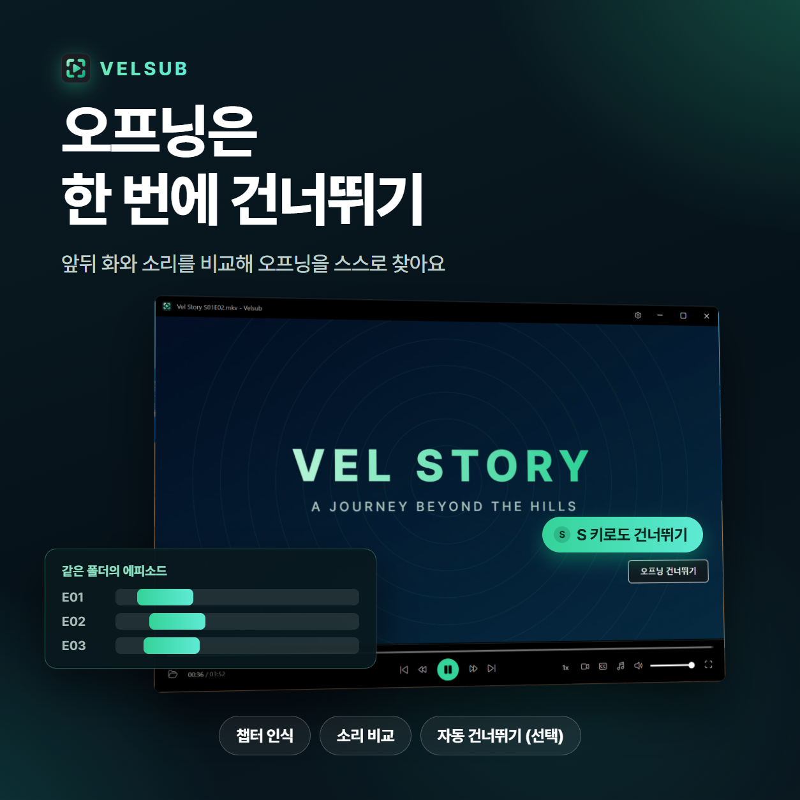
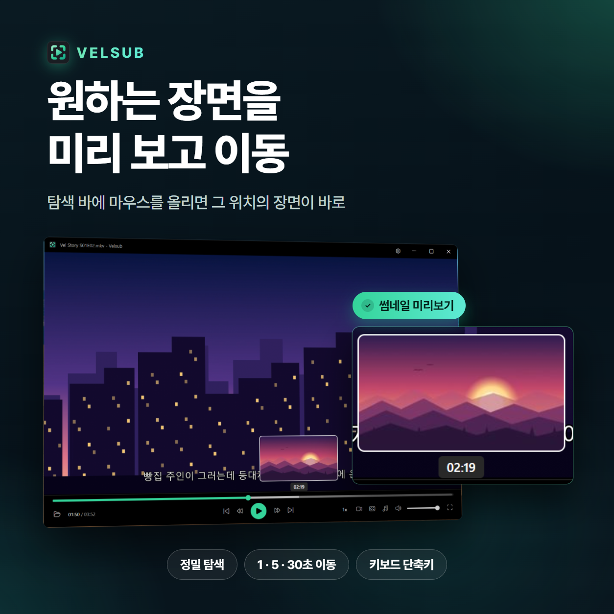
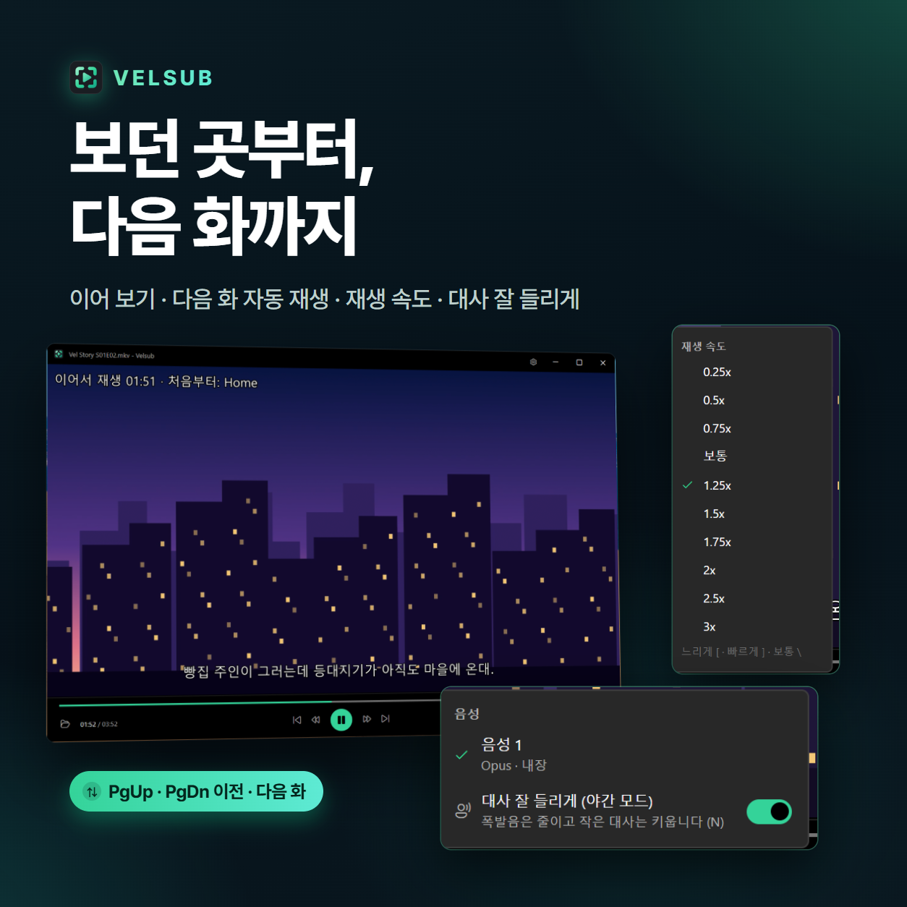
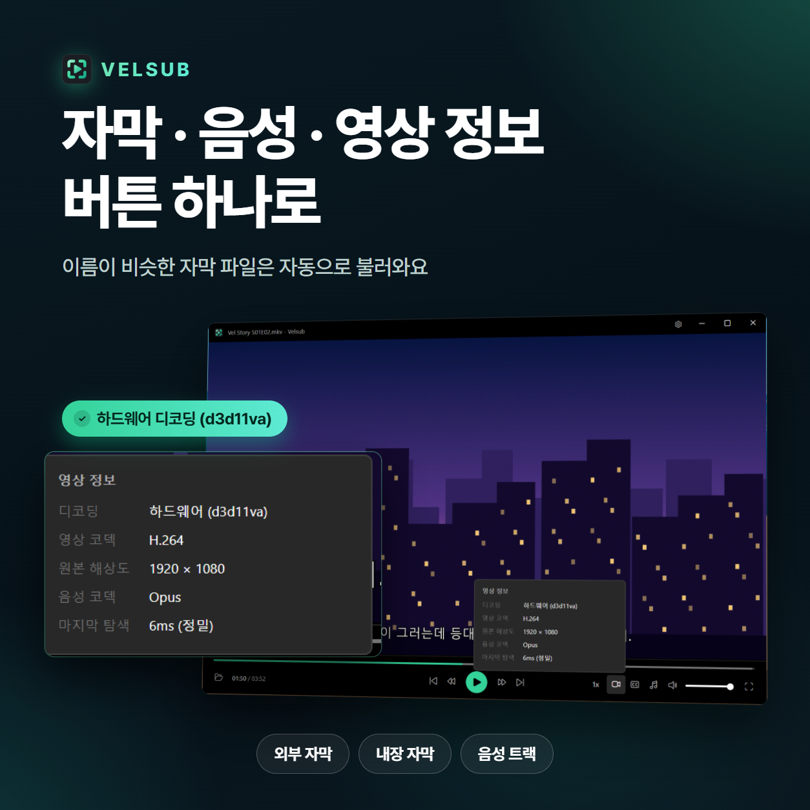
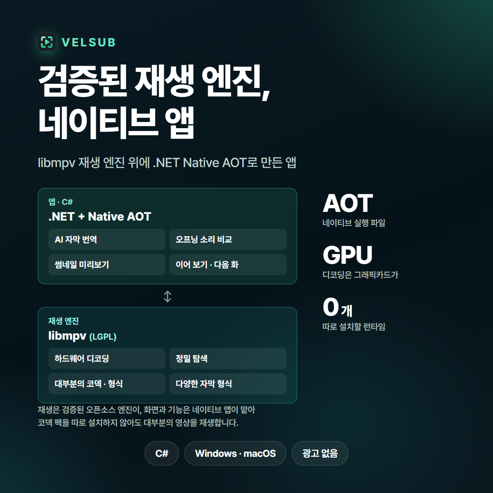

  

<h1 align="center">Velsub</h1>

외국어 자막을 AI로 바로 번역해 주는, 가볍고 빠른 동영상 플레이어

  <b>한국어</b> · <a href="README.en.md">English</a>

  <a href="https://github.com/vel-apps/velsub/releases/latest"><b>⬇ 최신 버전 다운로드</b></a>

## 주요 기능

- **AI 자막 번역** — 자막 패널에서 "AI 번역"을 누르면 지금 고른 자막을 번역해 번역된 줄부터 바로 화면에 보여 주고, 영상 옆에 SRT 파일로 저장합니다. Gemini 또는 ChatGPT(OpenAI) API 키를 씁니다.
- **오프닝 건너뛰기** — 오프닝 구간에서 "오프닝 건너뛰기" 버튼이 뜹니다. 챕터가 없어도 같은 폴더의 앞뒤 화와 소리를 비교해 오프닝을 스스로 찾습니다. 자동으로 건너뛰게 할 수도 있습니다.
- **탐색 바 미리보기** — 탐색 바에 마우스를 올리면 그 위치의 장면이 썸네일로 나옵니다.
- **빠른 키보드 탐색** — 방향키 한 번은 정확한 위치로, 꾹 누르면 화면이 멈추지 않고 빠르게 넘어갑니다.
- **이어 보기 · 다음 화** — 다시 열면 보던 곳부터, 끝나면 같은 폴더의 다음 화를 이어서 재생합니다.
- **재생 속도 · 대사 잘 들리게** — 음 높이를 유지한 채 0.25~3배 속도, 큰 소리는 줄이고 작은 대사는 키우는 야간 모드.
- **자막 · 음성 트랙** — 파일 안 자막과 영상 옆 자막 파일을 한 목록에서 고르고, 이름이 비슷한 자막 파일은 자동으로 불러옵니다 (SRT · SMI · ASS · WebVTT).
- **하드웨어 디코딩** — 그래픽카드로 영상을 디코딩하고, 코덱 팩을 따로 설치하지 않아도 대부분의 영상을 재생합니다.
- **한국어 · 영어** — Windows 표시 언어를 따르고, 설정에서 직접 고를 수도 있습니다.

| | |
|---|---|
|  |  |
|  |  |
|  |  |

## 설치

1. [Releases](https://github.com/vel-apps/velsub/releases/latest)에서 `Velsub-<버전>-win-x64.zip`을 받습니다.
2. 원하는 곳(예: `D:\Apps\Velsub`)에 압축을 풉니다.
3. `Velsub.exe`를 실행합니다. 따로 설치할 프로그램은 없습니다.
4. 영상을 더블클릭해서 Velsub으로 열려면: 설정 → 파일 연결.
5. 업데이트: Velsub을 끄고, 새 zip의 파일을 기존 폴더에 덮어쓰면 됩니다. 설정과 이어 보기 기록은 그대로 남습니다.

### 처음 실행할 때 "Windows의 PC 보호" 창이 뜨면

<b>[추가 정보] → [실행]</b>을 누르세요. 아직 코드 서명이 되어 있지 않은 새 프로그램이라 Windows가 한 번 확인하는 것입니다.

## AI 자막 번역 쓰기

1. API 키를 준비합니다 (본인 계정의 키를 씁니다. 사용량에 따른 요금은 각 서비스의 정책을 따릅니다).
   - Gemini: [Google AI Studio](https://aistudio.google.com/apikey)
   - ChatGPT: [OpenAI API keys](https://platform.openai.com/api-keys)
2. 설정 → AI 번역에서 서비스를 고르고 키를 넣습니다. 번역할 언어도 여기서 고릅니다 (한국어 · 영어 · 일본어 · 중국어 간체).
3. 영상을 열고 CC 버튼 → **AI 번역**을 누릅니다.

- 키는 이 PC의 사용자 계정으로 암호화해 보관하고, 번역할 자막 글자 말고는 다른 곳으로 보내지 않습니다.
- 번역 자막은 영상 옆에 `영상이름.AI번역.ko.srt`로 저장되고, 다음에 열면 자동으로 불러옵니다.
- 중간에 멈추거나 Velsub을 꺼도, 다시 CC → "AI 번역 이어하기"로 남은 줄만 번역합니다.
- 이미지로 된 자막(PGS, VobSub)은 아직 번역하지 못합니다.

## 시스템 요구사항

- Windows 10 또는 Windows 11, 64비트
- 하드웨어 동영상 디코딩을 지원하는 그래픽카드 권장

## 사용 팁

| 단축키 | 동작 |
|---|---|
| `←` `→` | 5초 이동 (`Shift`: 1초, `Ctrl`: 30초 · 설정에서 변경) |
| `Space` | 재생 / 일시정지 |
| `↑` `↓` · 마우스 휠 | 볼륨 |
| `S` | 오프닝 건너뛰기 (버튼이 떠 있을 때) |
| `PgUp` `PgDn` | 이전 / 다음 파일 |
| `Home` | 처음부터 재생 |
| `[` `]` `\` | 느리게 / 빠르게 / 보통 속도 |
| `C` | 자막 켜기 / 끄기 |
| `N` | 대사 잘 들리게 (야간 모드) |
| `M` | 음소거 |
| `Enter` · 영상 더블클릭 | 전체화면 |
| `Ctrl` + `O` | 파일 열기 |
| `Ctrl` + `,` | 설정 |

- 단축키는 설정 → 단축키에서 동작마다 두 개까지 바꿀 수 있습니다.
- 영상과 자막 파일을 창에 끌어다 놓아도 열립니다.
- 설정은 `%APPDATA%\Velsub`에 저장됩니다.
- 제거: 압축을 푼 폴더를 지우면 됩니다. 설정까지 지우려면 `%APPDATA%\Velsub`, `%LOCALAPPDATA%\Velsub` 폴더도 지웁니다. 파일 연결을 했다면 지우기 전에 설정 → 파일 연결에서 해제하세요.

## 문제 신고 · 의견

[Issues](https://github.com/vel-apps/velsub/issues)에 남겨 주세요.

## 이용 안내

Velsub은 누구나 부담 없이 쓸 수 있도록 **무료로 배포**합니다. 개인·업무 용도 모두 자유롭게 사용하세요.

정성껏 만들고 여러 번 확인했지만, 모든 PC 환경과 모든 영상에서 언제나 완벽하게 동작한다고 약속드리기는 어렵습니다.
AI 번역은 참고용이며 원문과 다르게 번역될 수 있습니다. 사용 중 생긴 문제나 데이터 손실에 대해서는 책임을 지기 어려운 점 너그럽게 양해해 주세요.
대신 불편한 점을 [Issues](https://github.com/vel-apps/velsub/issues)에 알려 주시면 더 나은 Velsub을 만드는 데 소중히 반영하겠습니다.

## 라이선스

© 2026 SHOCAT

Velsub은 재생 엔진으로 [libmpv](https://mpv.io)(LGPL)를 씁니다. Velsub에 포함된 오픈소스 구성 요소와 라이선스, 소스 위치는 [THIRD-PARTY-NOTICES.txt](THIRD-PARTY-NOTICES.txt)에 있습니다.
